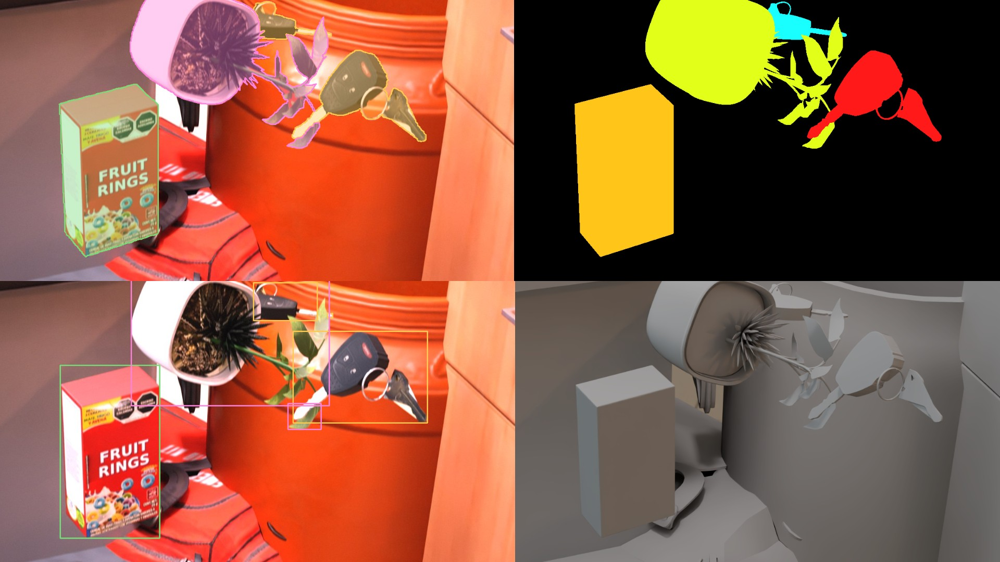

# Synthetic Data Generation for Detection/Segmentation Models

Generating synthetic data pipeline for YOLO object detection and segmentation, built on NVIDIA
Isaac Sim Replicator. It renders randomized frames of any real life object using its 3D model, converts
the instance masks into YOLO labels and splits them into a ready2train dataset.

The models in results/weights are trained only on these synthetic frames. No real image
is ever used for training, and the real phone videos in tests/videos are used only for
measuring.

All 3D models used in this repo were fully modeled using Claude and an image as reference. 



https://github.com/ferestradaa/SyntheticDataYolo/raw/main/docs/synthetic_linked.mp4

## How it works

- `run/generate_data.sh` runs four stages in order, all driven by run/config.yaml.

- `src/generate_data.py` launches Isaac Sim headless with path tracing, loads the assets
plus 62 Isaac warehouse, hospital and office props as distractors, and renders the
requested number of randomized frames with their instance masks.

- `src/extract_masks.py` splits each instance segmentation image into one binary mask per
instance under masks, and writes classes.txt.

- `src/make_labels.py` traces every mask into a YOLO polygon label under labels_raw, writing
an empty label for frames with no objects so YOLO reads them as negatives.

- `src/split_dataset.py` hardlinks the pairs into images and labels under train and val,
writes data.yaml, and with --clean keeps one example in sample_check and deletes the raw
files.

### Randomization

`src/domain_randomization.py` handles layout, object poses and scales, which instances are
visible, distractor placement, camera position, framing and focal length.

`src/lighting.py` drives a dome light from one of six styles: overcast, window, indoor,
mixed, backlit and dim. 

src/camera_effects.py applies a lens and sensor pass to the rendered image: barrel
distortion, chromatic aberration, defocus and motion blur, bloom, vignette, exposure and
white balance, sensor noise and JPEG recompression. 


## Quick start

1. Install Isaac Sim 4.2/4.5 [here](https://web.archive.org/web/20260103134909/https://docs.isaacsim.omniverse.nvidia.com/4.5.0/installation/download.html)

2. Point the config at your Isaac Sim install
   
3. Setup the large of the dataset to generate (numer of frames and dir output name). Check `run/config.yaml`

```
isaac_sim_path: /path/to/your/isaacsim/installation
data_dir: data_generated/data_1000
num_frames: 1000
```

Then generate:

```bash
bash run/generate_data.sh
```

Extra arguments are passed through to the generator and override the config, which is the
fastest way to check a change before committing to a long run:

```bash
bash run/generate_data.sh --num_frames 10 --data_dir data_generated/smoke
```

The result is a YOLO dataset, with sample_check holding one frame in every intermediate
form so the run can be eyeballed:

```
data_generated/data_1000/
  data.yaml            train and val paths, nc and class names
  classes.txt          id:name, in the order the labels use
  frames_meta.json     what each frame was supposed to show
  images/train/        the rendered frames
  images/val/
  labels/train/        one polygon per line: cls x1 y1 x2 y2 ...
  labels/val/
  sample_check/        one frame with its label, mask and raw render
```

Adding a class is one line under assets plus the .usd in meshes. Nothing else needs to
change, because the class list is discovered from the rendered semantics.


## Training

The datasets train with the stock ultralytics CLI, there is no wrapper in this repo. What
produced the weights in results/weights:

```bash
yolo segment train model=yolo11n-seg.pt data=data_generated/data_2000b/data.yaml \
  epochs=100 imgsz=640 batch=16 seed=0 \
  hsv_h=0.03 hsv_s=0.7 hsv_v=0.5 degrees=10 translate=0.15 scale=0.7 \
  mosaic=1.0 mixup=0.15 copy_paste=0.15 erasing=0.4
```
The final models were trained on 2000 frames, 1800 train and 200 val, rendered at 960x960
before the random phone crop.

## Running on real video

```bash
python tests/eval_video.py tests/videos/kitchen_day.MOV --task segment
```

This writes an annotated mp4 and a json dump of the surviving tracks next to it. It
applies tests/track_filter.py, which drops any track shorter than 15 frames, below 0.55
mean confidence or covering less than half a percent of the frame, and runs at conf 0.70.


## Repo layout

```
run/           config.yaml and the one script that runs the whole pipeline
src/           the four pipeline stages plus the randomization modules
meshes/        the four target objects as .usd, with their textures
hdri/          dome lighting environments, 2k
blender/       the scripts that rebuilt the meshes from photographs
tests/         evaluation on real video, not unit tests
results/       weights, training curves, annotated videos and the write-up
```

## Assets and credits

The four objects were rebuilt from phone photographs rather than downloaded: proportions
solved by PnP and bundle adjustment, textures projected from the photos, brand marks
removed. 

The HDRIs come from Poly Haven, polyhaven.com, under CC0, downscaled to 2k. The
distractor props and surface textures are referenced from the Isaac Sim asset server at
run time and are not redistributed here.
